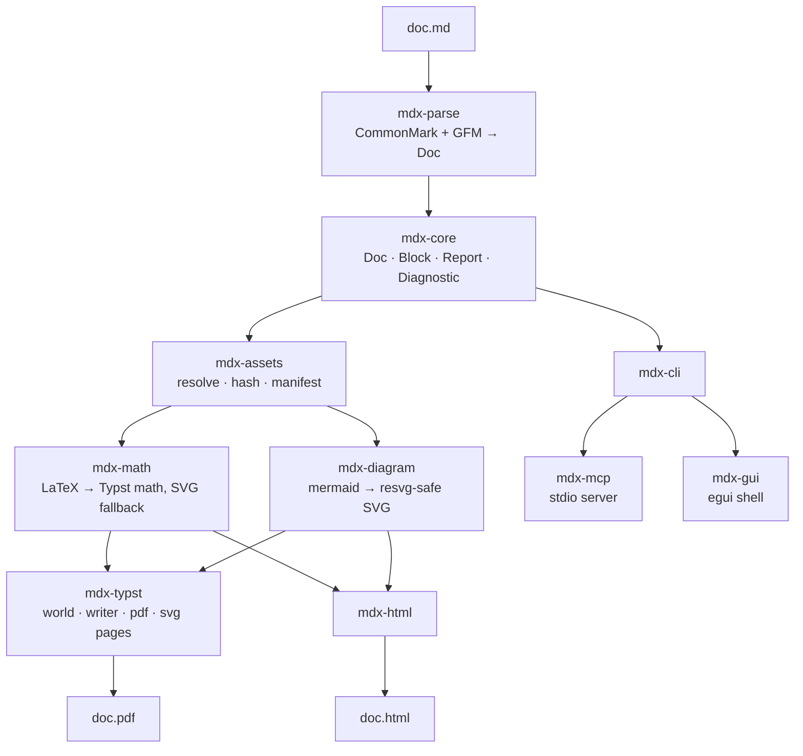

# mdx

Markdown to PDF, in one binary.

`mdx` turns a Markdown file into a PDF (or a self-contained HTML page) without a
browser, a LaTeX distribution or a Pandoc installation. It parses CommonMark
plus the GitHub extensions, resolves the images the document references,
converts LaTeX math, renders Mermaid diagrams, and typesets the result with
[Typst](https://typst.app). The same pipeline is reachable from the command
line, from an MCP server, and from a desktop preview shell.

## Why

Document toolchains usually stack several runtimes (Pandoc → LaTeX → external
diagram renderers) and every layer brings its own configuration, its own failure
modes and its own output drift. `mdx` keeps the whole path in one Rust workspace
with a frozen internal contract:

- **One pipeline, three front ends.** `mdx-cli`, `mdx-mcp` and `mdx-gui` all run
  the same stages, so a document that renders from the shell renders from an
  editor or an agent too.
- **Deterministic by default.** Assets are content addressed, iteration is
  sorted, the clock is fixed (`--deterministic`) and no stage reads the
  environment, so the same input produces byte-identical output.
- **Offline first.** Remote assets are opt-in; `--offline` refuses them, and a
  local render never opens a socket.
- **Machine-readable failures.** Every diagnostic carries a stable code
  (`E_ASSET_MISSING`, `E_MATH_CONVERT`, …), a severity and, where possible, a
  position, and `--json` prints them as one object. Exit codes distinguish "the
  document is broken" from "the assets are broken".
- **No `unsafe`, no panics on user input.** Failures travel as
  `mdx_core::Diagnostic` values, never as aborts.

Milestone M1 covers `mdx render`, `mdx check`, `mdx ast` and `mdx assets`
end-to-end: parse → assets → math/diagrams → Typst → PDF.

## Install

From a checkout (Rust 1.95 or newer; the workspace uses the 2024 edition):

```console
$ cargo build --release
$ ./target/release/mdx --help
```

or install the binary into `~/.cargo/bin`:

```console
$ cargo install --path crates/mdx-cli
$ mdx --help
```

The binary is named `mdx`; no system fonts, TeX or browser is required — the
fonts the renderer needs are packaged with the build.

## CLI

```console
# Markdown to PDF.
$ mdx render doc.md -o doc.pdf

# A self-contained HTML page instead, with a table of contents.
$ mdx render doc.md --format html -o doc.html --toc

# A Letter-sized PDF/A-2b file using a specific font, with the clock pinned.
$ mdx render doc.md -o doc.pdf --paper letter --pdf-standard a-2b --font ./Inter.ttf
$ mdx render doc.md -o doc.pdf --ignore-system-fonts --deterministic --jobs 4

# Diagnostics only: exit status and codes, nothing written.
$ mdx check doc.md
$ mdx check doc.md --json

# The parsed document model (`mdx-ast/1`).
$ mdx ast doc.md
$ mdx ast doc.md --json

# The resolved asset manifest (`mdx-assets/1`).
$ mdx assets doc.md --json
```

`mdx render` flags: `-o/--output`, `--format pdf|html`, `--toc`, `--paper
a4|letter`, `--pdf-standard a-2b|ua-1`, `--font PATH` (repeatable),
`--ignore-system-fonts`, `--offline`, `--deterministic`, `--jobs N`, `--json`.

With `--json` every subcommand prints exactly one object on stdout:

```json
{ "ok": true, "exit": 0, "diagnostics": [], "output": "doc.pdf", "manifest": null }
```

`output` is the path that was written, `manifest` is the asset manifest
(`mdx-assets/1`) for `mdx assets`, and either is `null` when the command
produced neither. A failing run still prints the envelope, with `ok: false` and
the exit status it will return.

Without `--json`, `mdx ast` and `mdx assets` print the document model
(`mdx-ast/1`) and the manifest on stdout, and `mdx check` prints its diagnostics
on stderr, so a clean check stays silent on stdout.

## Exit codes

| code | meaning |
|-----:|---------|
| `0` | success |
| `1` | render or parse failure |
| `2` | usage or configuration error |
| `3` | unresolved assets (missing, offline or unsupported) |

## Architecture



| crate | responsibility |
|-------|----------------|
| `mdx-core` | document model (`mdx-ast/1`), diagnostic codes, exit codes |
| `mdx-parse` | comrak → model, YAML front matter, heading slugs, TOC |
| `mdx-assets` | relative/`data:`/remote resolution, hashing, MIME, manifest |
| `mdx-math` | LaTeX → Typst math, RaTeX SVG fallback |
| `mdx-diagram` | Mermaid → SVG, with a content-addressed cache |
| `mdx-typst` | Typst world (virtual files, packaged fonts, fixed clock), writer, PDF, SVG pages |
| `mdx-html` | one self-contained HTML file |
| `mdx-cli` | the `mdx` binary |
| `mdx-mcp` | MCP tools `md_parse`, `md_check`, `md_assets`, `md_render`, `md_math` over stdio |
| `mdx-gui` | desktop shell with an editor pane, preview and diagnostics |

## Development

```console
$ cargo fmt --all -- --check
$ cargo clippy --workspace --all-targets -- -D warnings
$ cargo test --workspace
```

`fixtures/notes/` holds the documents the integration test in
`tests/smoke.rs` drives through the real binary — a clean document, CJK text,
tables, math, diagrams, images, front matter, footnotes, nesting, data URIs, a
missing asset and a ~2000 line stress document. `fixtures/math/` and
`fixtures/diagrams/` hold the conversion corpora with their expected values.

CI runs the formatting check, Clippy with warnings denied, the whole test
suite, the license audit and a release build on Ubuntu, and uploads the
`mdx` binary as a build artifact.

## License

`mdx` is dual-licensed under either of

- Apache License, Version 2.0
- MIT license

at your option, and contributions are accepted under the same terms.

Third-party dependencies must stay compatible: `scripts/license-audit.sh`
resolves the dependency graph with `cargo metadata` and fails when a package
carries a GPL, AGPL, SSPL or EPL license. It runs in CI, and it prints every
license it sees (including LGPL and packages without an SPDX expression) so the
report can be reviewed without re-running the resolver.
