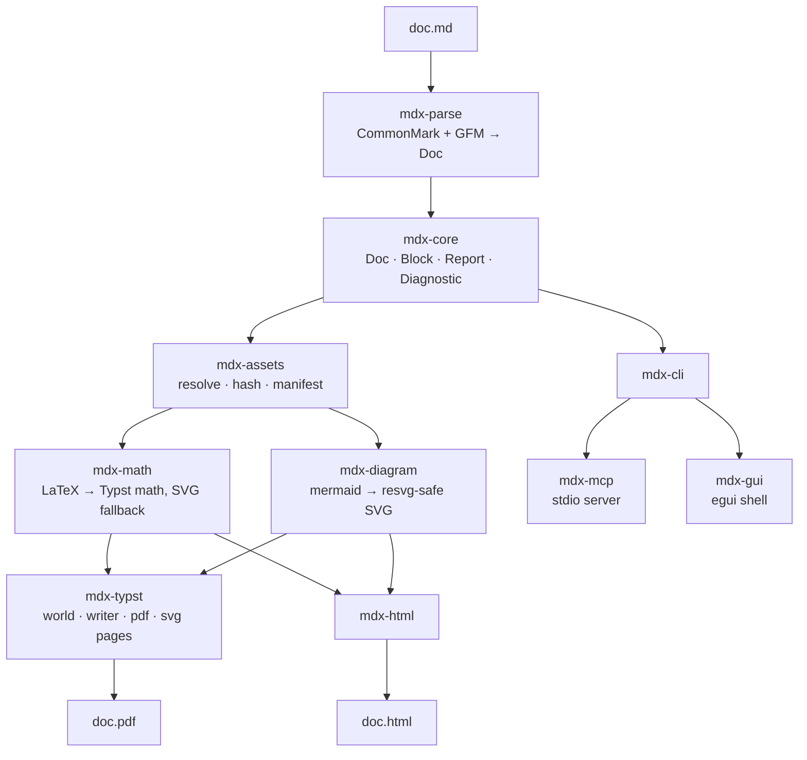

# mdx

Markdown to PDF, in one binary.

`mdx` turns a Markdown file into a PDF (or a self-contained HTML page) without a
browser, a LaTeX distribution or a Pandoc installation. It parses CommonMark
plus the GitHub extensions, resolves the images the document references,
converts LaTeX math, renders Mermaid diagrams, and typesets the result with
[Typst](https://typst.app). The same pipeline is reachable from the command line,
from an MCP server, and from a desktop editor.

- [Why](#why)
- [Install](#install)
- [CLI](#cli)
- [Watch mode](#watch-mode)
- [Desktop editor](#desktop-editor)
- [MCP server](#mcp-server)
- [Determinism and fonts](#determinism-and-fonts)
- [Architecture](#architecture)
- [Performance](#performance)
- [Development](#development)
- [License](#license)

## Why

Document toolchains usually stack several runtimes (Pandoc → LaTeX → external
diagram renderers) and every layer brings its own configuration, its own failure
modes and its own output drift. `mdx` keeps the whole path in one Rust workspace
with a frozen internal contract:

- **One pipeline, three front ends.** `mdx`, `mdx-mcp` and `mdx-gui` run the same
  stages, so a document that renders from the shell renders from an editor or an
  agent too.
- **Deterministic by default.** Assets are content addressed, iteration is
  sorted, the clock is fixed and no stage reads the environment, so the same
  input produces byte-identical output.
- **Offline first.** Remote assets are opt-in; `--offline` refuses them, and a
  local render never opens a socket.
- **Machine-readable failures.** Every diagnostic carries a stable code
  (`E_ASSET_MISSING`, `E_MATH_CONVERT`, …), a severity and, where possible, a
  position, and `--json` prints them as one object. Exit codes distinguish "the
  document is broken" from "the assets are broken".
- **No `unsafe`, no panics on user input.** Failures travel as
  `mdx_core::Diagnostic` values, never as aborts.

## Install

### Arch Linux

```console
$ cd packaging
$ makepkg -si
```

The recipe builds the workspace in release mode and installs `mdx`, `mdx-mcp`
and `mdx-gui`, the desktop entry, the icon and a systemd user unit for the MCP
server. CJK text in a PDF needs a CJK font, which is why the package suggests
`noto-fonts-cjk`. See [`packaging/README.md`](packaging/README.md) for the
system libraries `mdx-gui` links against.

### From source

Rust 1.95 or newer (the workspace is edition 2024):

```console
$ cargo build --release --workspace
$ ./target/release/mdx --help
```

That produces all three binaries:

| binary | what it is |
|--------|------------|
| `target/release/mdx` | the command line tool |
| `target/release/mdx-mcp` | the MCP server (stdio) |
| `target/release/mdx-gui` | the desktop editor |

To install just the CLI into `~/.cargo/bin`:

```console
$ cargo install --path crates/mdx-cli
```

`mdx` itself needs no system fonts, TeX or browser: the fonts the renderer uses
are packaged with the build.

### Release archive

`scripts/release.sh` builds the workspace, strips the binaries and writes
`dist/mdx-<version>-<target>.tar.gz` with `bin/mdx`, `bin/mdx-mcp`,
`bin/mdx-gui`, the desktop entry and the README.

## CLI

```console
# Markdown to PDF.
$ mdx render doc.md -o doc.pdf

# A self-contained HTML page instead, with a table of contents.
$ mdx render doc.md --format html -o doc.html --toc

# A Letter-sized PDF/A-2b file using a specific font.
$ mdx render doc.md -o doc.pdf --paper letter --pdf-standard a-2b --font ./Inter.ttf

# A build that does not depend on this host's fonts.
$ mdx render doc.md -o doc.pdf --ignore-system-fonts --deterministic --jobs 4

# Diagnostics only: exit status and codes, nothing written.
$ mdx check doc.md
$ mdx check doc.md --json

# The parsed document model (`mdx-ast/1`).
$ mdx ast doc.md

# The resolved asset manifest (`mdx-assets/1`).
$ mdx assets doc.md --json

# The heading tree.
$ mdx outline doc.md
$ mdx outline doc.md --json

# The generated Typst markup, to see what the writer emitted.
$ mdx render doc.md --dump-typst doc.typ
```

`mdx render` flags:

| flag | meaning |
|------|---------|
| `-o`, `--out OUT` | output path (default: the input path with the format's extension) |
| `--format pdf\|html` | output format, default `pdf` |
| `--toc` | add a table of contents (PDF) |
| `--paper a4\|letter` | page size, default `a4` |
| `--pdf-standard a-2b\|ua-1` | enforce a PDF conformance standard |
| `--font PATH` | font file to use; repeatable (see [fonts](#determinism-and-fonts)) |
| `--ignore-system-fonts` | do not use the fonts installed on this host |
| `--offline` | never read remote assets; they fail with `E_ASSET_OFFLINE` |
| `--deterministic` | reproducible output: fixed build date, deterministic diagram text |
| `--jobs N` | maximum number of conversion workers, default `1` |
| `--dump-typst PATH` | also write the generated Typst markup (debugging aid) |
| `--json` | print one machine-readable JSON object instead of the default output |

`mdx check`, `mdx ast`, `mdx assets` and `mdx outline` take an input file and
`--json`. `mdx outline` prints an indented tree (`<title> (<id>)`, two spaces per
level) and, with `--json`, the bare array
`[{"level":1,"id":"intro","title":"Intro"}, …]`.

With `--json`, `render`, `check`, `ast` and `assets` print exactly one object on
stdout:

```json
{ "ok": true, "exit": 0, "diagnostics": [], "output": "doc.pdf", "manifest": null }
```

`output` is the path that was written, `manifest` is the asset manifest
(`mdx-assets/1`) for `mdx assets`, `ast` is added by `mdx ast`, and each is
`null` when the command produced none. A failing run still prints the envelope,
with `ok: false` and the exit status it will return.

Without `--json`, `mdx ast` and `mdx assets` print the document model
(`mdx-ast/1`) and the manifest on stdout, `mdx outline` prints the tree, and
`mdx check` prints its diagnostics on stderr, so a clean check stays silent on
stdout.

### Exit codes

| code | meaning |
|-----:|---------|
| `0` | success |
| `1` | render or parse failure |
| `2` | usage or configuration error |
| `3` | unresolved assets (missing, offline or unsupported) |

## Watch mode

`mdx watch` repeats a `render` build whenever the input file changes. It watches
exactly one file — the path given on the command line — and accepts every
`render` build flag with the same defaults, so a watched build is the build
`mdx render` would produce:

```console
$ mdx watch notes/design.md --format pdf --toc -o /tmp/design.pdf
$ mdx watch notes/design.md --debounce-ms 800
$ mdx watch notes/design.md --once        # one build, no watching
```

The first build starts as soon as the file is readable — so a fresh `mdx watch`
shows a result instead of idling for the next save, and `watching <input>
(Ctrl-C to stop)` goes to stderr. After that the loop asks the file for its
modification time every 250 ms and rebuilds once the change has been quiet for
`--debounce-ms` milliseconds (default `400`, so a save that arrives as several
writes still produces one build; `0` rebuilds on the first observed change).
stdout carries exactly one line per build:

```console
built /tmp/design.pdf in 412 ms
error E_ASSET_MISSING: notes/logo.png does not exist
```

Warnings keep their position information on stderr. A failed build does not end
the loop: the previous output stays on disk and the next save rebuilds again. An
input that cannot be read is reported once and then polled until it comes back.
`-o` must not name the file being watched — rewriting it would change its
modification time and rebuild forever — so that pair is refused as a usage error
(exit `2`). Only Ctrl-C stops continuous mode; `--once` prints its single status
line and exits with that build's code (`0`, `1`, `2` or `3`).

## Desktop editor

```console
$ mdx-gui notes/design.md
```

The shell is an editor pane beside a live preview of the rendered pages.

- **Open** a document from the command line, by dropping a `.md`/`.markdown` file
  onto the window, from the `File` menu, by typing a path in the `File` field and
  pressing `Reload`, or with `Ctrl+O` (which focuses the path field). `File →
  Recent files` lists the last ten documents, newest first, and `File → Clear
  recent list` empties it; the list lives in `$XDG_STATE_HOME/mdx/recent.json`
  (`~/.local/state/mdx/recent.json`), and a missing or unreadable file is simply
  ignored.
- **Actions:** `Save` (`Ctrl+S`), `Reload` (`Ctrl+R`, asks before discarding
  unsaved edits), `Render PDF` (`Ctrl+E`) and `F5` to rebuild.
- **Toggles:** `Line numbers`, `Current line`, `Contents` (table of contents in
  the PDF), `Diagnostics`, and `Outline`, whose headings scroll the source pane to
  the matching line.
- **Tabs:** `Preview`, `AST` and `Assets` — the last two summarise the parsed
  document model and the resolved assets, the same data the `mdx ast` and
  `mdx assets` commands print.
- **Preview:** all pages in one continuous scroll, `Fit width` on by default, a
  zoom control from `0.25×` to `4.00×` with `50 %`, `100 %`, `150 %` and `200 %`
  presets, and a `Go to page` field to jump to a page; each page header shows its
  number, its size in points and its scale.
- **Status bar:** caret position as `L:C`, page count, word and character counts,
  and how long the last build took.
- **Pasted images:** copy a screenshot and press `Ctrl+V` in the editor; the PNG is
  written to `assets/pasted-<hash>.png` beside the document and a Markdown image
  reference is inserted at the caret. The bytes are embedded on export, so the
  PDF/HTML stays a single file.

`mdx-gui` links against a GL/EGL stack and a window system (`libglvnd`, `libx11`,
`libxkbcommon`, `libwayland`).

## MCP server

`mdx-mcp` is a Model Context Protocol server over stdio. It takes no arguments
and is spawned by the client, so it is configured rather than started:

```json
{
  "mcpServers": {
    "mdx": {
      "command": "mdx-mcp",
      "args": []
    }
  }
}
```

Point `command` at an absolute path (`/usr/bin/mdx-mcp`, or the binary in
`target/release/`) when the client does not inherit your `PATH`. Every tool takes
paths as strings and resolves relative paths against the server's working
directory.

| tool | answer |
|------|--------|
| `md_parse` | the `mdx-ast/1` document as JSON |
| `md_check` | `{ok, exit, diagnostics}` |
| `md_assets` | the `mdx-assets/1` manifest |
| `md_outline` | `{toc}` — one `{level, id, title}` per heading |
| `md_render` | `{output, bytes}` after writing PDF or HTML |
| `md_render_many` | `{results}` for a batch of files, where one file's failure does not abort the batch |
| `md_math` | `{typst}` or `{error, code}` for one formula |
| `md_version` | `{version, crates}` of the running toolchain |

Failures come back as `isError` results whose payload carries the same stable
diagnostic code the CLI uses; the server never panics.

## Determinism and fonts

The same input produces the same bytes:

- Assets are content addressed and deduplicated, and every iteration that reaches
  the output is sorted.
- The Typst world never reads the wall clock: it sees the fixed date
  `2026-01-01`, and the PDF metadata records that same date, so repeated exports
  of one document are byte-identical — which is also what PDF/A, a standard that
  requires a document date, needs to validate.
- Diagram text is measured with merman's deterministic model unless font files
  are given, so the rendered geometry does not depend on the machine's installed
  fonts or on the clock.

`--deterministic` states that intent explicitly — it pins the build date and the
deterministic diagram text — which is what a script or a CI job should use.

Fonts are the one thing that can differ between machines:

- The renderer always has the faces bundled with the build — Libertinus Serif,
  New Computer Modern and DejaVu Sans Mono — so a Latin document needs nothing
  installed.
- `--font PATH` adds or overrides a family; it is repeatable, and the same files
  are also used to measure Mermaid label text.
- CJK text needs a CJK face. `mdx` scans the usual font directories for known CJK
  families unless `--ignore-system-fonts` is given. For a hermetic build, list
  the font explicitly instead:

```console
$ scripts/install-fonts.sh
mdx render doc.md -o doc.pdf --font /usr/share/fonts/noto-cjk/NotoSansCJK-Regular.ttc
$ mdx render doc.md -o doc.pdf --ignore-system-fonts \
      --font /usr/share/fonts/noto-cjk/NotoSansCJK-Regular.ttc
```

`scripts/install-fonts.sh` only detects and prints; it installs nothing.

## Architecture



| crate | responsibility |
|-------|----------------|
| `mdx-core` | document model (`mdx-ast/1`), diagnostic codes, exit codes |
| `mdx-parse` | comrak → model, YAML front matter, heading slugs, TOC |
| `mdx-assets` | relative/`data:`/remote resolution, hashing, MIME, manifest |
| `mdx-math` | LaTeX → Typst math, RaTeX SVG fallback |
| `mdx-diagram` | Mermaid → SVG, with a content-addressed cache |
| `mdx-typst` | Typst world (virtual files, packaged fonts, fixed clock), writer, PDF, SVG pages |
| `mdx-html` | one self-contained HTML file |
| `mdx-cli` | the `mdx` binary |
| `mdx-mcp` | the MCP server |
| `mdx-gui` | the desktop editor |

`docs/ARCHITECTURE.md` describes the data flow, the invariants and the failure
recovery; `docs/CONTRACT.md` is the frozen per-crate interface and
`docs/ROADMAP.md` tracks the milestones. `CHANGELOG.md` lists user-visible
changes per release.

## Performance

```console
$ scripts/bench.sh                      # end-to-end `mdx render` timings
$ CARGO_TARGET_DIR=target cargo run --release --manifest-path benchmarks/Cargo.toml -- \
      fixtures/notes/large.md --runs 3 --jobs 1
```

`scripts/bench.sh` generates synthetic documents, renders them with `--jobs 1`
and `--jobs 4`, and prints median wall time, peak RSS and PDF size; peak RSS needs
GNU `/usr/bin/time` (it prints `n/a` without it, Arch: `pacman -S time`). The
`benchmarks/` crate measures the pipeline stages inside one process. Measured
baselines live in `benchmarks/README.md`, never in the scripts.

## Development

```console
$ cargo fmt --all -- --check
$ cargo clippy --workspace --all-targets -- -D warnings
$ cargo test --workspace
$ scripts/license-audit.sh
```

The integration suites in `crates/mdx-cli/tests/` drive the real binary over
`fixtures/notes/` and pin the contract that matters to a user: exit codes per
failure mode (`2` for a missing input, `3` for an unresolved asset, `1` for an
unwritable output, `0` with a `W_FRONTMATTER` warning for malformed front
matter), the `--json` output of every subcommand (`mdx outline` prints a bare
array where the others print the envelope), a `%PDF` output floor, and
byte-identical `--deterministic` re-renders. `cargo test -p mdx-cli` runs them
alone.

`fixtures/notes/` holds the documents those tests use — a clean document, CJK
text, tables, math, diagrams, images, front matter, footnotes, nesting, data
URIs, a missing asset, an adversarial set (`unicode`, `long-lines`, `empty`,
`only-math`) and a large stress document. `fixtures/math/` and
`fixtures/diagrams/` hold the conversion corpora with their expected values.

CI runs the formatting check, Clippy with warnings denied, the whole test suite,
the license audit and a release build, and uploads the `mdx` binary as a build
artifact.

## License

`mdx` is dual-licensed under either of

- Apache License, Version 2.0
- MIT license

at your option, and contributions are accepted under the same terms.

Third-party dependencies must stay compatible: `scripts/license-audit.sh`
resolves the dependency graph with `cargo metadata` and fails when a package
carries a GPL, AGPL, SSPL or EPL license. It runs in CI, and it prints every
license it sees (including LGPL and packages without an SPDX expression) so the
report can be reviewed without re-running the resolver.
