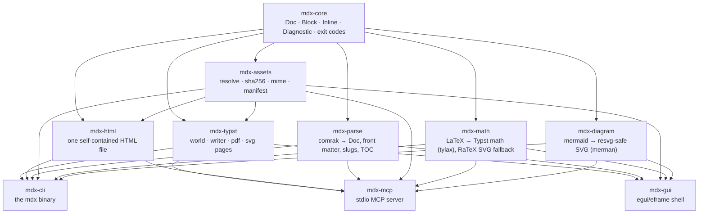

# mdx — architecture

How one Markdown file becomes a PDF, an SVG page set or a self-contained HTML
document, and which properties every stage is required to keep. The stage
signatures themselves live in [`CONTRACT.md`](./CONTRACT.md); this document is
about the shape of the pipeline and the invariants that hold across it.

## One pipeline, three front ends

`mdx-cli` (`mdx`), `mdx-mcp` (stdio server) and `mdx-gui` (eframe shell) are all
thin layers over the same crates. Nothing downstream of `mdx-core` knows whether
a document arrived from a shell, an editor pane or an MCP tool call, so a
document that renders from one front end renders from all of them. The CLI's
`pipeline` module is the reference sequencing: every other front end runs a
prefix of the same stages in the same order.

## Data flow

```text
source.md
   │  read (UTF-8)
   ▼
mdx-parse::parse ── comrak (CommonMark + GFM extensions)
   │                front matter → Doc::front, headings → Doc::toc
   │                mermaid fences → Block::Diagram, $…$ → Math / Inline::Math
   ▼
Doc (mdx-ast/1)  +  Report{Diagnostic}
   │  mdx-assets::resolve_all(&mut Doc, doc_dir, &AssetPolicy)
   │     fills Block::Image::asset / Inline::Image::asset with content-addressed ids
   ▼
AssetStore  +  Doc  +  Report           ← manifest (mdx-assets/1) via AssetStore::to_json
   │
   ├── math_map(Doc, jobs)     → MathMap      (BTreeMap<String,String>: LaTeX → Typst math body)
   ├── diagram_map(Doc, jobs)  → DiagramMap   (BTreeMap<String,String>: mermaid → SVG)
   │
   ▼
mdx-typst::writer::build(Doc, &AssetStore, &MathMap, &DiagramMap, &RenderOptions) → main.typ
   ▼
mdx-typst::world::World ── serves main.typ, /assets/<id>, /diagrams/<key>.svg in memory
   ▼
typst::compile(&World) → typst_layout::PagedDocument
   ├── mdx-typst::pdf::export(&PagedDocument, &RenderOptions) → PDF bytes
   └── mdx-typst::svg::render_pages(&PagedDocument)           → Vec<String> (one SVG per page)

Doc + AssetStore + MathMap + DiagramMap ──► mdx-html::render_html → one HTML string
```

Two stages are deliberately *not* in the `Doc`: the math and diagram maps are
keyed by the raw source text and computed after asset resolution, because a
formula or a Mermaid source that repeats anywhere in the document is converted
once and then looked up by the writer for every occurrence.

`mdx-cli` runs a prefix of this sequence per subcommand:

| subcommand | stages | writes |
|------------|--------|--------|
| `mdx render` | read → parse → assets → math → diagrams → render | PDF or HTML |
| `mdx check` | read → parse → assets → math validation | nothing |
| `mdx assets` | read → parse → assets | nothing (manifest on stdout) |
| `mdx ast` | read → parse | nothing (model on stdout) |

`render` refuses to write anything when the report already carries an error
(unresolved asset, failed diagram), so a failed build never leaves a
plausible-looking partial file behind.

## Crate dependency graph



Edges point from a dependency to its consumer: `mdx-core` is depended on by
everything and depends on nothing in the workspace; `mdx-cli`, `mdx-mcp` and
`mdx-gui` are leaf binaries that depend on the stage crates and are depended on
by nothing. No stage crate depends on a front end, and none depends on another
stage except through `mdx-core` (plus `mdx-assets` for the two writers, which
need `AssetStore`).

## Invariants

These hold for every stage and are what make output reproducible.

### Determinism

- **Sorted iteration.** Work items are collected into `BTreeSet`s
  (`mdx-cli::pipeline::collect_math`, `collect_diagrams`) and the maps the
  writers consume are `BTreeMap`s (`MathMap`, `DiagramMap`), so neither thread
  scheduling nor repetition in the document changes a rendered result.
- **No wall clock.** `mdx-typst::world::World::today` always answers with
  `RenderOptions::deterministic_today`, or `DEFAULT_TODAY` (`2026-01-01`) when
  the caller pins none; the host clock is never read. The PDF export carries no
  wall-clock value either — it omits the timestamp (`PdfOptions::timestamp =
  None` at HEAD) — so two exports of the same document are byte-identical.
- **Content addressing.** An asset id is `img-<sha256[..12]>` and a diagram file
  is `diagram-<fnv1a64(source)>`, so identical bytes/payloads share one entry and
  reordering the document never renames anything.
- **No environment, no randomness.** No stage reads a random source or a locale.
  The single environment variable any code path consults is `HOME`, and only to
  locate `$HOME/.local/share/fonts` / `$HOME/.fonts` in the CJK font scan. (M2
  adds `MDX_CACHE_DIR` for the diagram cache — see
  [`ROADMAP.md`](./ROADMAP.md#m29-diagram-robustness-and-on-disk-cache).)

### No ambient file system

- Parsing, asset resolution, math, diagrams and the Typst compile are pure with
  respect to the host: sources, assets and diagram SVGs are handed to the Typst
  world **in memory**.
- The only file-system reads in a HEAD render are the font files named in
  `RenderOptions::fonts` (plus the bounded CJK system-font scan, below) and the
  document/assets themselves. `--offline` removes the last network path. (M2 adds
  an on-disk diagram cache, the first stage-side file-system state — see
  [`ROADMAP.md`](./ROADMAP.md#m29-diagram-robustness-and-on-disk-cache).)
- The Typst world serves exactly three kinds of virtual path —
  `main.typ`, `/assets/<asset id>`, `/diagrams/<key>.svg` — and answers
  `FileError::NotFound` for anything else. Nothing is `#include`d; the generated
  source is one self-contained file.

### Font policy

- The bundled `typst-assets` fonts are always loaded first; `Libertinus Serif`
  is therefore always present and heads the writer's font stack.
- Typst ships no CJK face, so the world additionally scans a **narrow, bounded**
  set of known CJK families under `/usr/share/fonts`, `/usr/local/share/fonts`,
  `$HOME/.local/share/fonts` and `$HOME/.fonts` (`world::system_cjk_fonts`,
  ≤ 4 levels deep, family names matched against CJK markers, at most 6 files
  kept). `--ignore-system-fonts` turns the scan off for hermetic,
  byte-reproducible builds.
- `--font PATH` files are appended after the bundled and system fonts and are
  the single authority on what can be loaded: a file that cannot be read is
  `E_IO`, a file with no usable font is `E_IO`. A path that does not exist is an
  `E_CONFIG` warning (`pipeline::note_missing_fonts`) and is passed through
  unchanged.
- Diagram text metrics follow the same rule: `DiagramOptions::deterministic_text`
  (merman's built-in width model) is the default, and `DiagramOptions::font_files`
  (the same `--font` paths) switches measurement to those faces' `hmtx` advances.
  Merman's `native-fonts` / `system-fonts` backends are deliberately not enabled,
  so no rasterizer enters the dependency closure.

### Failure model

- Every fallible public function returns a `mdx_core::Diagnostic` (or a typed
  error carrying one). Diagnostics carry a stable `DiagCode`, a `Severity` and,
  when known, a 1-based line/column; none of them are renames, only additions.
- `E_*` codes with `Severity::Error` are fatal; `W_*` codes are never fatal even
  when their severity was constructed inconsistently (`Diagnostic::is_fatal`).
- No `unsafe`, and no `unwrap`/`expect`/`panic!` on user input or parse results.
  The one third-party black box that may panic (`tylax`, inside `mdx-math`) is
  called behind a panic guard, and the CLI's worker pool re-runs a slice on the
  calling thread if a worker dies.

#### Per-formula probe (math failure recovery)

A formula that Typst cannot express must not take the document down with it:

1. `mdx_math::latex_to_typst` is tried first. On success the expression enters
   `MathMap`.
2. On failure, `mdx_math::latex_to_svg` is *probed* — purely to find out whether
   the formula is drawable at all. Its SVG feeds a different pipeline than
   `MathMap`, so it is not used for Typst output.
3. If RaTeX draws it, the document keeps the **source LaTeX** and reports
   `E_MATH_CONVERT` as a **warning**; the writer passes the original LaTeX
   through rather than failing. If neither converter handles it, the warning
   explains both failures.

A diagram has no such fallback: a Mermaid source that cannot be rendered is an
`E_DIAGRAM_RENDER` error, because silently dropping a figure is worse than not
building. An unresolved asset is likewise an `E_ASSET_*` error, and the CLI
short-circuits before rendering.

#### Second probe: `mdx-typst::compile`

Conversion can succeed and Typst can still reject the expression — the LaTeX
converter is permissive. So the compile step probes too, on the failure path
only:

1. Build the world and compile. Success returns the `PagedDocument`.
2. On Typst errors, walk the math map in key order and compile each candidate
   expression on its own, in a throwaway world holding one display equation;
   the first one that fails is removed from the map.
3. Rebuild and retry. The writer then passes that formula's original LaTeX
   through instead of the broken expression.
4. When no formula can be blamed — or the map is already empty — the error is
   the document's, and surfaces as `E_TYPST` with the first error's line and
   column in the generated `main.typ`.

The loop terminates because every iteration removes exactly one key.

#### Degradation in the writer

The writer never emits a dangling reference. If an asset did not resolve, an
image becomes its alternative text; if a diagram was not rendered, its block
becomes a `mermaid` code block; an unknown footnote reference becomes a footnote
holding its label; raw HTML blocks are dropped (Typst has no HTML passthrough).

## Exit codes

Process exit codes are owned by `mdx_core::exit` and are stable:

| code | constant | meaning |
|-----:|----------|---------|
| `0` | `OK` | success |
| `1` | `FAILED` | parse or render failure |
| `2` | `USAGE` | usage or configuration error |
| `3` | `ASSETS` | unresolved assets (missing, offline or unsupported) |

`mdx_core::exit_code(&Report)` returns `ASSETS` when any diagnostic carries an
asset code, `FAILED` when the report carries any other fatal error, and `OK`
otherwise. The MCP tools report the same numbers in their `{ok, exit,
diagnostics}` payload.

## Threading

`mdx-cli::pipeline::parallel_map` runs the math and diagram conversions over at
most `--jobs N` worker threads (clamped to the item count; `1` runs inline). Each
chunk reports `(index, result)` pairs so results keep the input order, and a
worker that dies does not abort the run: its slice is converted again on the
calling thread, which is also where a broken converter's panic would surface.
Nothing else in the pipeline is concurrent, and no shared mutable state crosses
a worker boundary.
