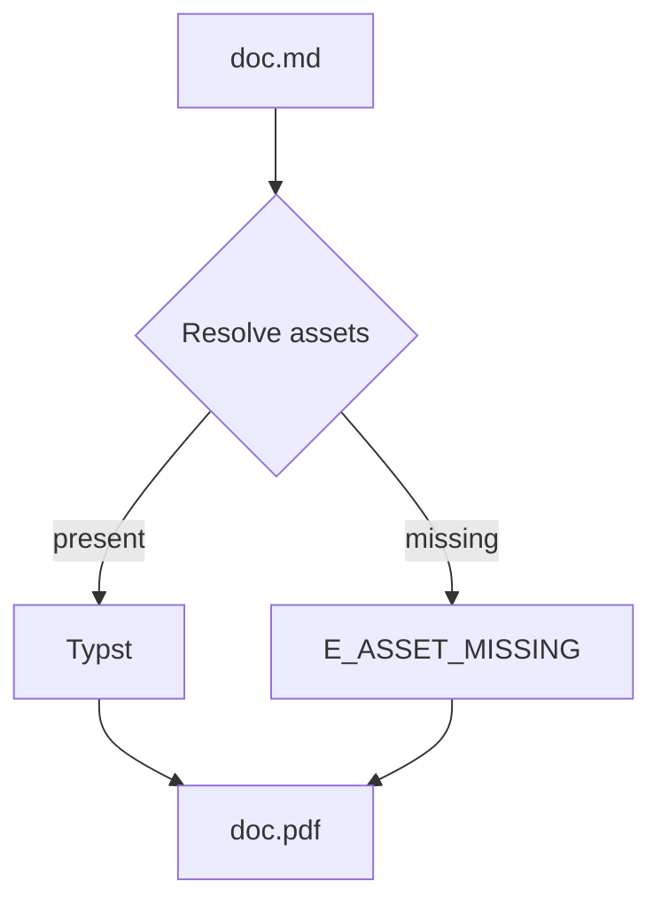
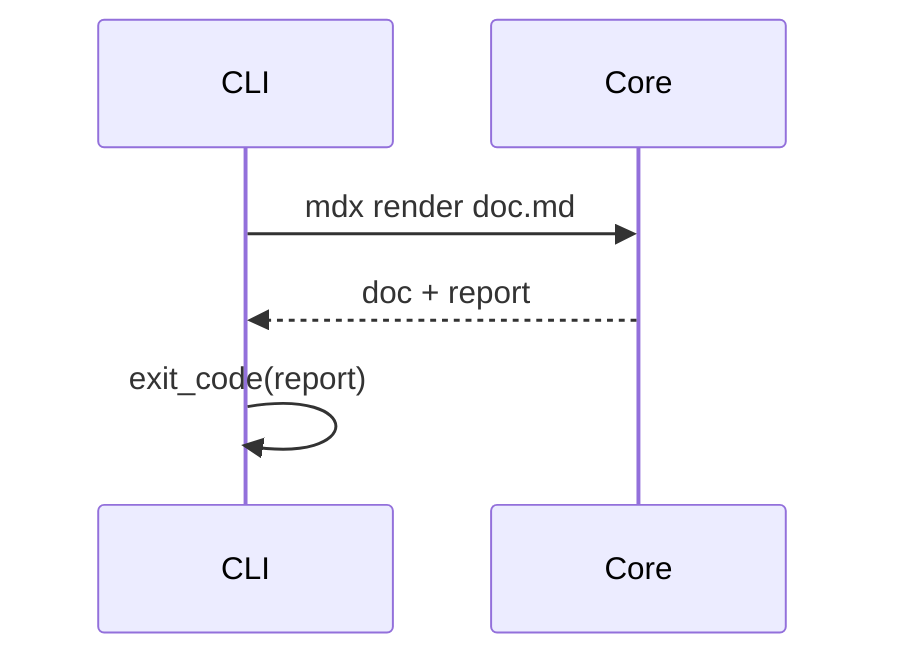
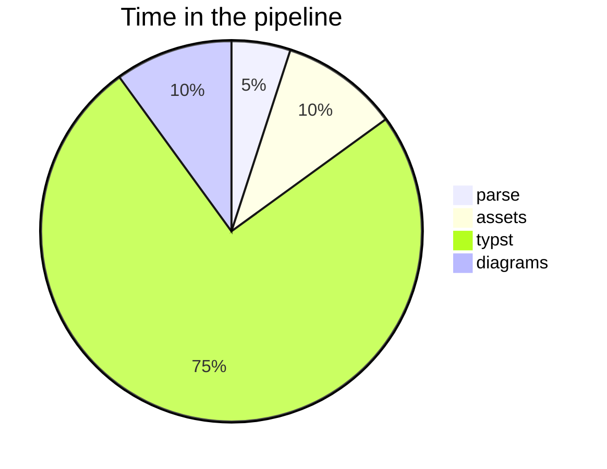

# Diagrams

A `mermaid` fenced block becomes a rendered SVG figure instead of a code
listing; every other info string stays a code block.

## Flowchart



## Sequence diagram



## Pie chart



## Not a diagram

An info string other than `mermaid` keeps the block as code:

```text
flowchart LR
    A --> B
```
